# 普吉岛旅游规划

**2027/2/8—2/13｜两人｜当地预算 ¥4,000 内，机票酒店另计。** 以下均为当地时间。

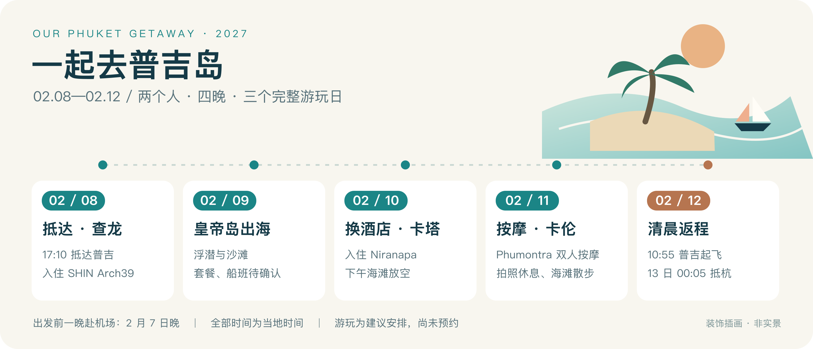

## 每天怎么玩

- **2/7**：23:15 左右到杭州萧山 T4。
- **2/8**：新加坡转机 → 17:10 抵普吉 → 住查龙、晚餐休息。
- **2/9**：皇帝岛＋珊瑚岛；参考 08:45 集合、16:30 回查龙，以所订套餐为准。
- **2/10**：12:00 前退房 → 卡塔酒店寄存、午餐 → 15:00 起入住 → 卡塔海滩＋夜市。
- **2/11**：Phumontra 卡图区店按摩、拍照（拟 12:00—14:00）→ 卡伦海滩看晚霞。
- **2/12**：暂定 06:00 离店、07:45 到机场；10:55 飞新加坡，**2/13 00:05 抵杭州**。

备选：三湾观景台或普吉老街，替换部分海滩时间；本次日期赶不上周日夜市。

## 机票与酒店

- **2/8 SQ839**：杭州 T4 **02:15 → 新加坡 07:15**。
- **2/8 SQ736**：新加坡 T2 **16:10 → 普吉（国际）17:10**。
- **2/12 SQ727**：普吉（国际）**10:55 → 新加坡 14:05**。
- **2/12 SQ838**：新加坡 T3 **18:30 → 杭州 T4 2/13 00:05**。
- 新加坡转机：去程 **8 小时 55 分钟**，回程 **4 小时 25 分钟**。
- **2/8—2/10**：SHIN Arch39 Phuket Beach Front（查龙）。
- **2/10—2/12**：Niranapa Boutique Resort（卡塔）。

## 吃什么、在哪里买

- **午餐**：[The Pad Thai Shop](https://www.xiaohongshu.com/explore/6a5f9cb3000000001f01d194)，虾仁炒粉、牛肉面；排队久换 [ReBe](https://rebe-restaurant.com/en/menu/)。
- **晚餐**：[Kata Walking Street Market](https://www.xiaohongshu.com/explore/6a980d99000000002902fdf7)，看黄油虾、鱿鱼、水果；两人先按 **400～600 泰铢额度**选购。
- **出海**：[去哪儿](https://touch.piao.qunar.com/touch/detail_33057.html?in_track=travel_touch_bybd_yyy)／[携程](https://huodong.ctrip.com/ottd-activity/dest/t52496524.html)。问清 **2/9 两成人总价、登岛时长、SHIN 接送、午餐浮潜、天气退改**。
- **按摩**：[Phumontra 卡图区店](https://phumontraspa.co/)，两人各 120 分钟；电话 **+66 62 061 6128**。时段、价格待确认。

## 两人预算

**约 ¥3,742～3,942**，含新加坡转机餐饮 ¥200～400。

普吉预留 **16,100 泰铢**：出海 5,000＋按摩 2,400＋吃喝 3,500＋交通 4,200＋机动 1,000。按 1 泰铢≈¥0.22 估算；属于预算，非锁定报价。不含机酒、购物、国内机场交通及可退押金。

## 出发前打勾

- [ ] **订项目**：皇帝岛 2/9、按摩 2/11；确认各项实付价。
- [ ] **问接送**：2/8 接机、2/12 清晨送机；确认酒店押金、寄存及行李直挂；决定新加坡是否入境。
- [ ] **备资料**：护照有效期至少 6 个月，保存英文机票、酒店凭证。
- [ ] **备现金**：1 月下旬用中行 App“外币现钞预约”或 **95566**办理。备查现金有每人 1 万／2 万泰铢两种官方口径，临行向泰方确认；可带等值外币现金。
- [ ] **填入境卡**：两人各填，官方免费。建议 **2/7 填 [泰国 TDAC](https://tdac.immigration.go.th/)**（首晚 SHIN）；如入境新加坡，**2/7、2/11 分别填两次 [SGAC](https://eservices.ica.gov.sg/sgarrivalcard/)**。均在抵达前 3 天内、含当天；仅在新加坡国际中转区转机则无需 SGAC。

航班按 2026/10/29 官网截图核对，四段已确认；其余资料核查于 2026/10/25。营业、2027 报价和入境政策临行复核。

> [!info]- 参考截图与来源（按需展开）
> **航班**：本次新航官网截图，仅保留航班区域。
> 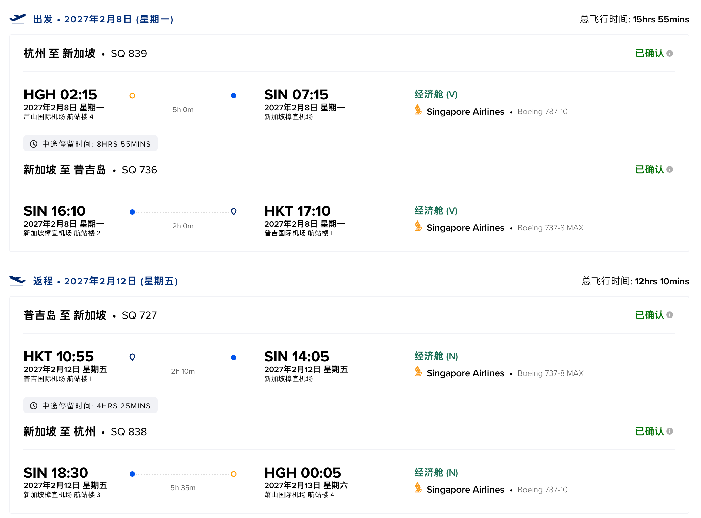
>
> **住宿与活动位置**：示意图，非导航地图。
> 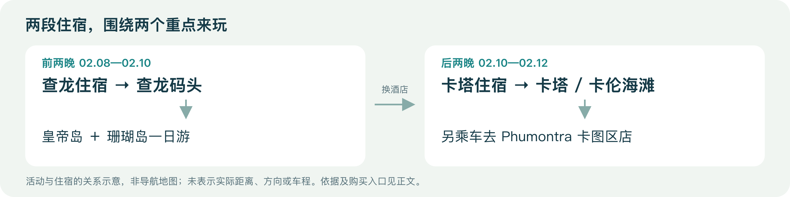
>
> [船公司行程](https://nikornmarinetourphuket.com/packages/351)：集合、回港及项目内容。
> 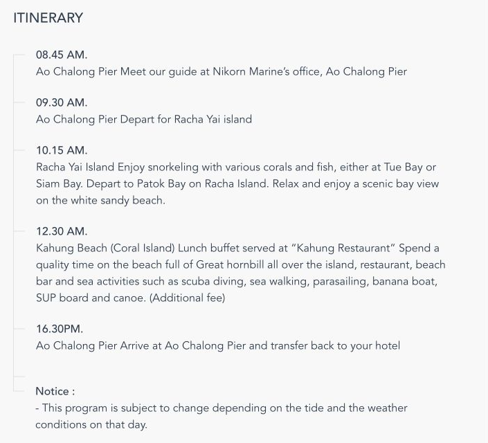
> [去哪儿套餐](https://touch.piao.qunar.com/touch/detail_33057.html?in_track=travel_touch_bybd_yyy)：起价未选日期，非出行报价。
> 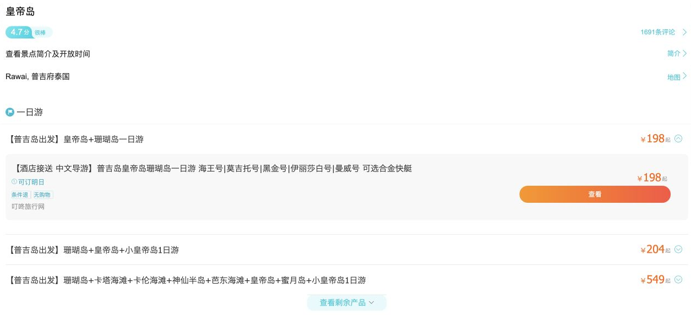
> [Phumontra 官网](https://phumontraspa.co/)：核对卡图区店与电话；[历史价格](https://www.divejctphuket-tour.com/blog/2025/07/22/phu-montra-phuket/)仅供预算。
> 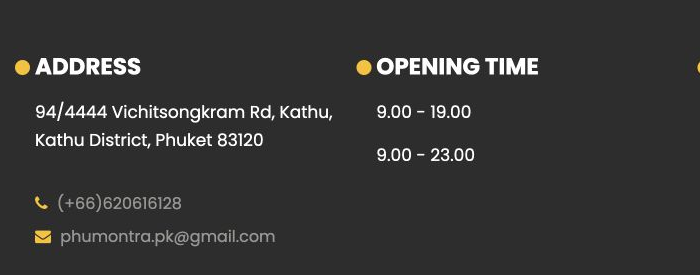
>
> [炒粉店体验](https://www.xiaohongshu.com/explore/6a5f9cb3000000001f01d194) · [市场体验](https://www.xiaohongshu.com/explore/6a980d99000000002902fdf7) · [海滩体验](https://www.xiaohongshu.com/explore/6ac370f30000000002010ce7)：游客个人分享。
> 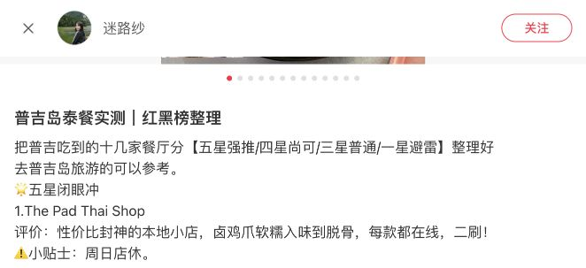
> 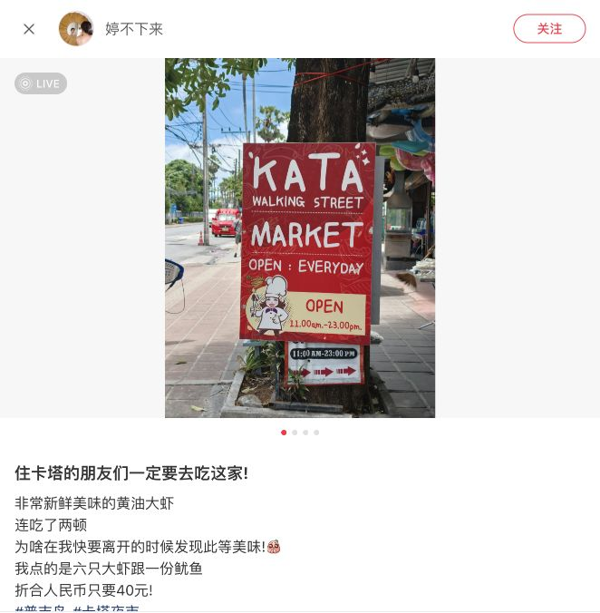
> 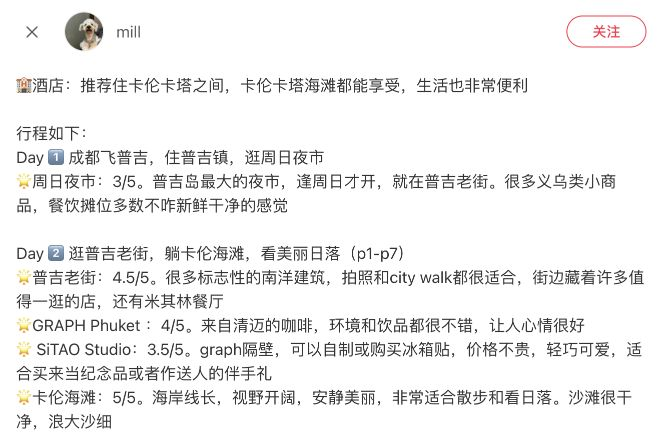
> [ReBe 官方菜单](https://rebe-restaurant.com/en/menu/)：当前菜单参照。
> 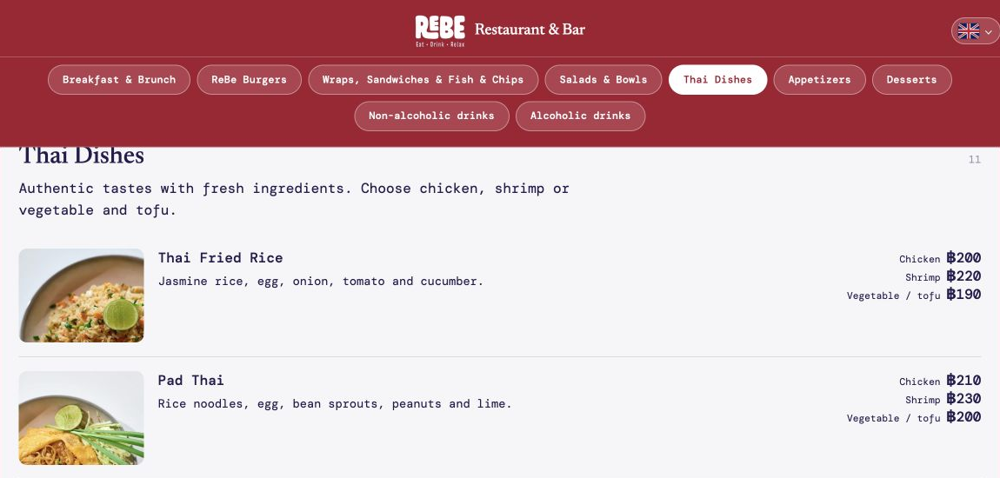
>
> [TDAC 官方说明](https://tdac.immigration.go.th/manual/en/faq.html) · [新加坡 ICA](https://www.ica.gov.sg/enter-transit-depart/entering-singapore/sg-arrival-card)。
> 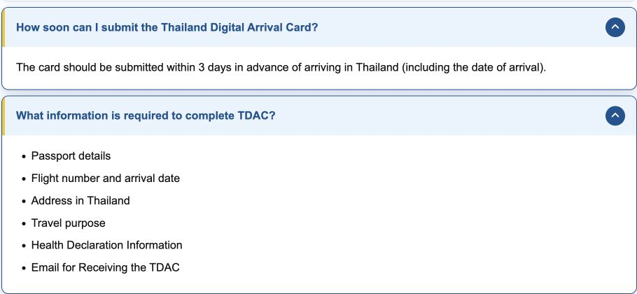
> 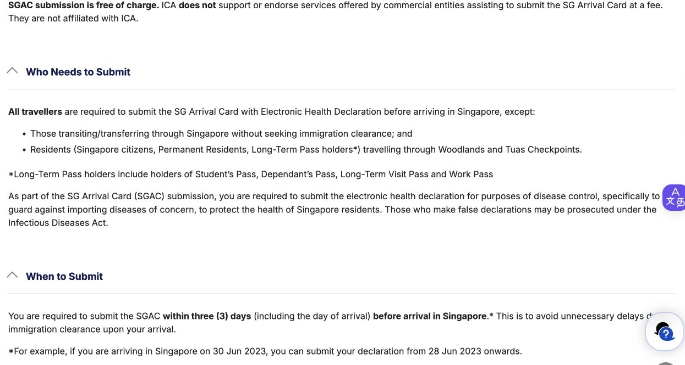
> [中行换汇](https://www.boc.cn/pbservice/pb4/200806/t20080626_767.html)。
> 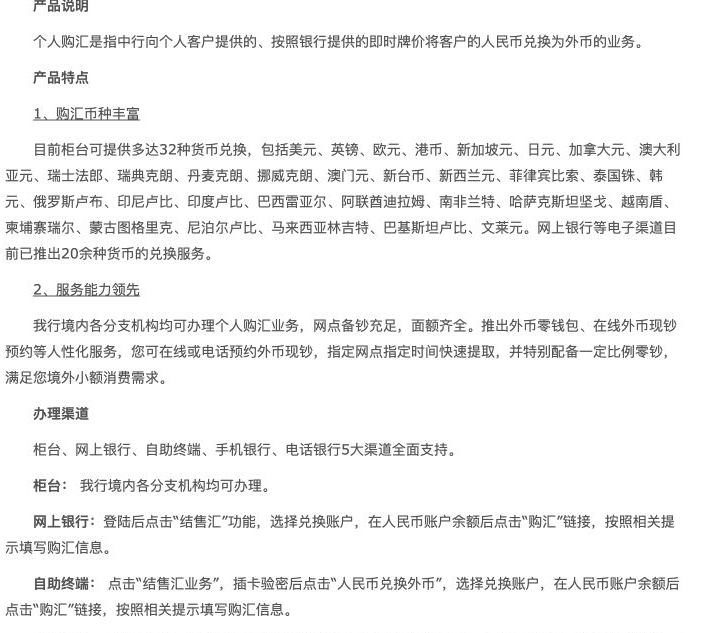
> [中国使馆现金提醒](https://th.china-embassy.gov.cn/chn/sgxw/202606/t20260609_11940504.html) · [泰国使馆一般免签页](https://washingtondc.thaiembassy.org/en/page/visaexempt-voajul2024)：保留不同口径对照。
> 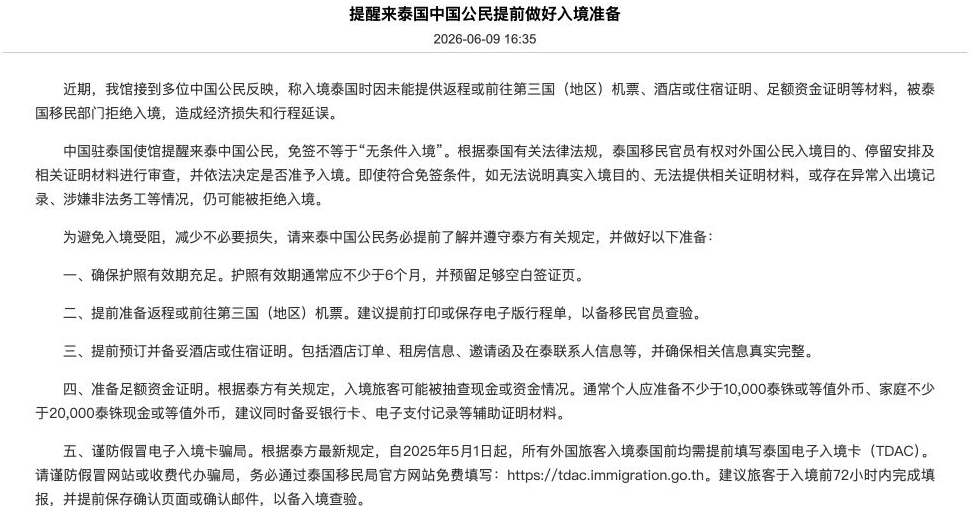
> 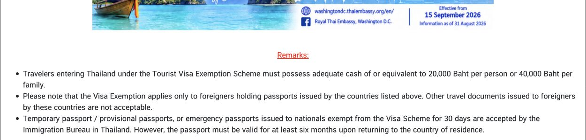
>
> 酒店已付 ¥3,085.70；SHIN／Niranapa 取消截止截图分别为北京时间 2/5／1/12 01:00，年份和完整规则以订单为准。
> [卡塔](https://www.phuket.go.th/eng/Beaches-Kata%20Beach.php) · [卡伦](https://www.phuket.go.th/eng/Beaches-Karon%20Beach.php) · [三湾观景台](https://www.phuket.go.th/eng/View%20point-Three%20Bay.php) · [老街与周日夜市](https://thailand.go.th/public/visit-thailand-detail/001_02_174)。
> [详细核查记录](资料/2027年泰国普吉岛旅行计划-详细核查记录.md) · [小红书出处](资料/小红书玩法与美食核查.md) · [截图索引](资料/网页截图索引.md)。
> [精简前完整版](资料/普吉岛旅游规划-精简前完整版-20261029.md)。
