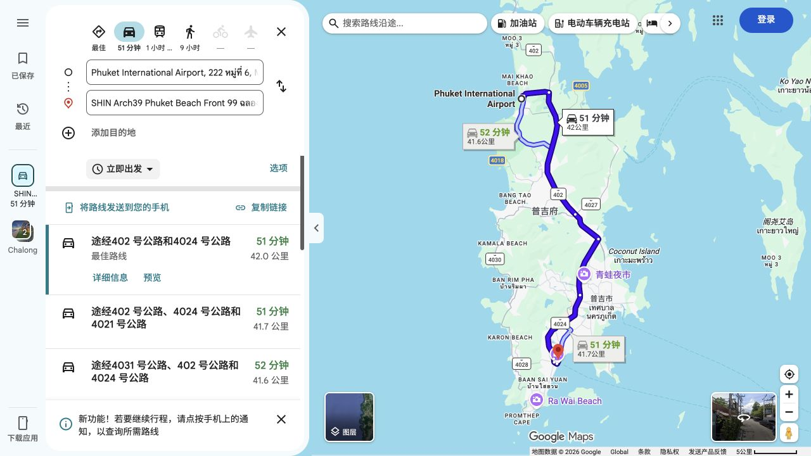
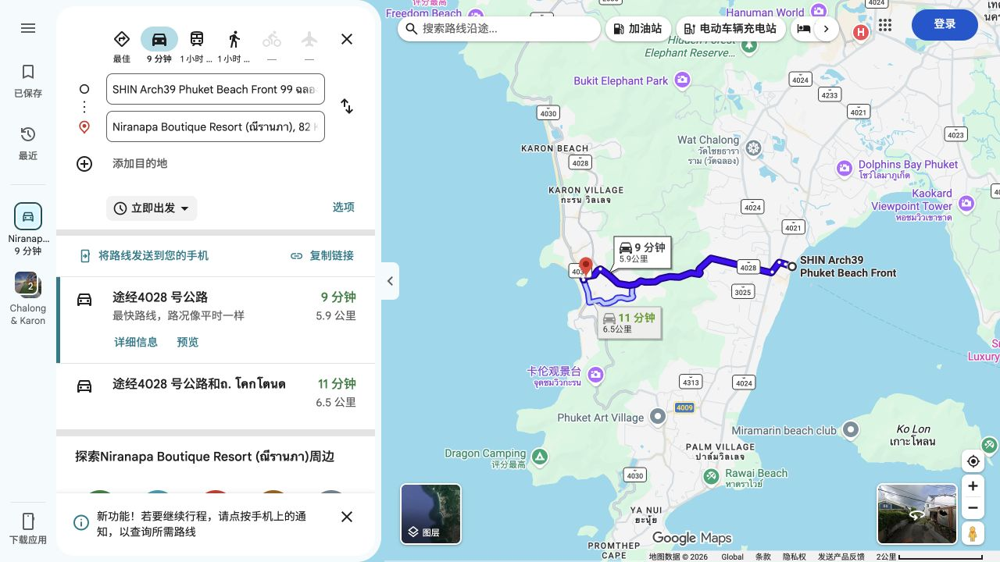
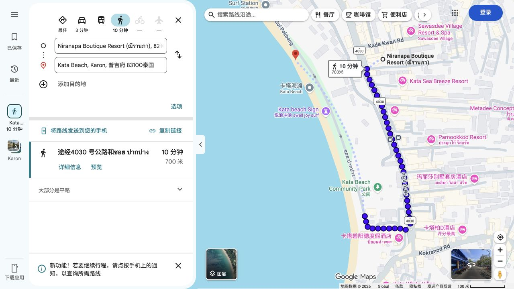
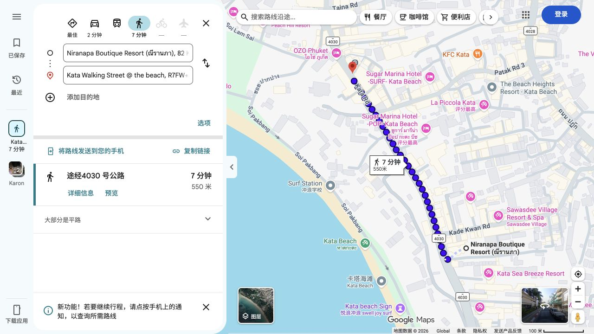
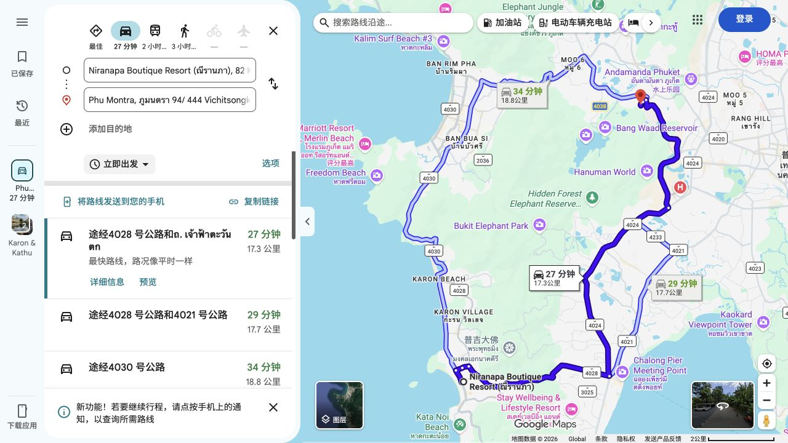
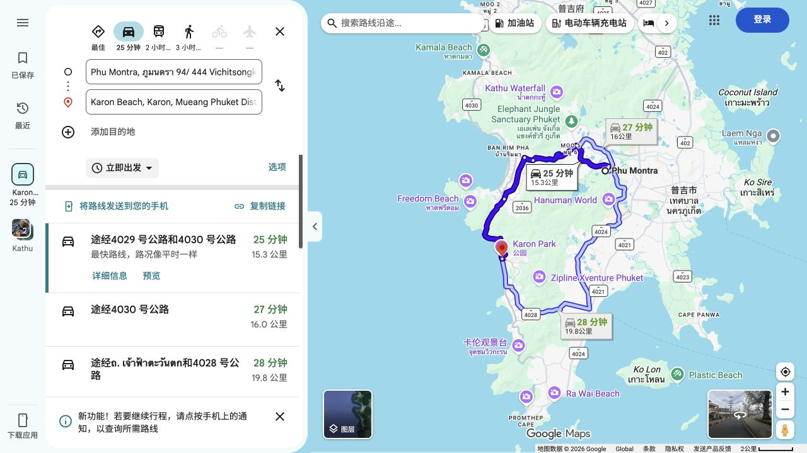
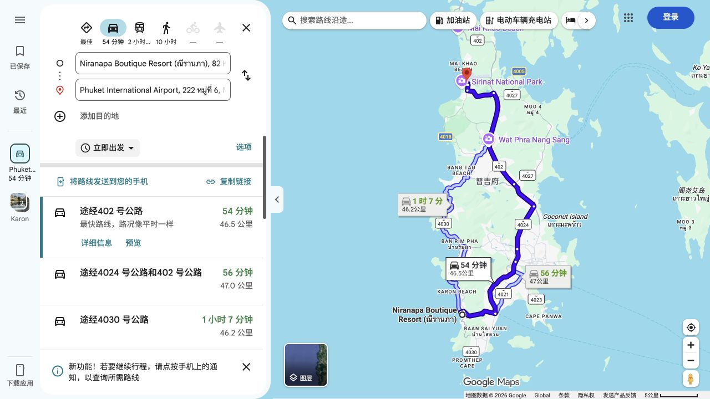
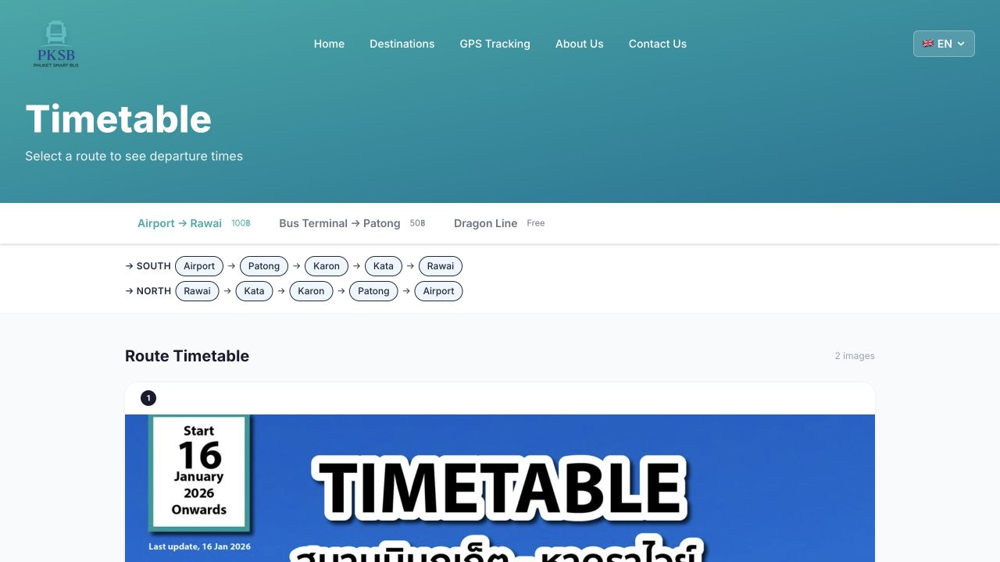
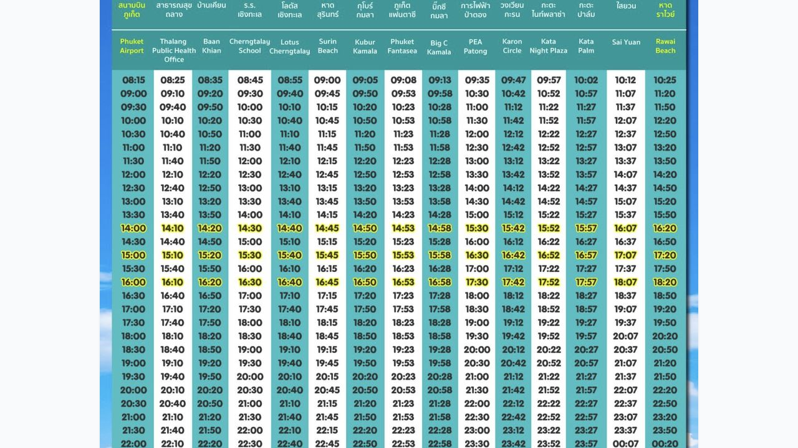
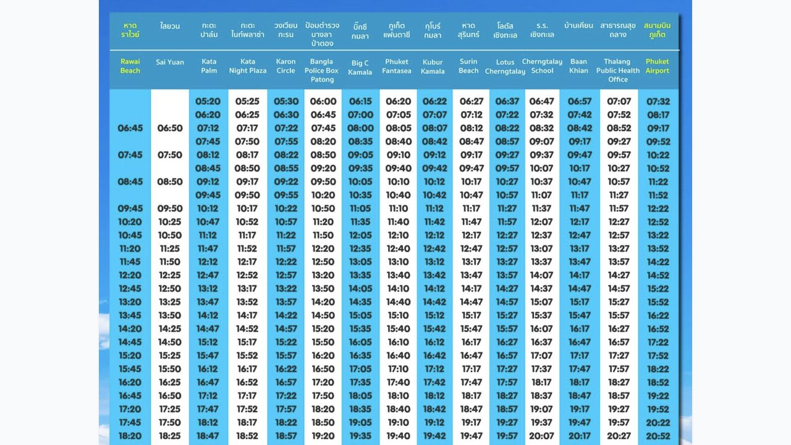

# 交通路线核查｜2026-10-29

当前 Google 地图“立即出发”快照，不能用于承诺 2027-02 的车程；驾车用时不含候车。海滩终点是地图地点标记，实际上下车点需双方约定。推荐方式是基于所查路线、两人分摊及携带行李作出的规划判断。

## 机场到查龙酒店

汽车 51 分钟／42.0 公里；公共交通约 1 小时 59 分钟。[打开路线](https://www.google.com/maps/dir/?api=1&origin=Phuket+International+Airport&destination=SHIN+Arch39+Phuket+Beach+Front&travelmode=driving)

## 换酒店

汽车 9 分钟／5.9 公里；公共交通约 1 小时 1 分钟。[打开路线](https://www.google.com/maps/dir/?api=1&origin=SHIN+Arch39+Phuket+Beach+Front&destination=Niranapa+Boutique+Resort+Phuket&travelmode=driving)

## 酒店到卡塔海滩

步行 10 分钟／700 米。[打开路线](https://www.google.com/maps/dir/?api=1&origin=Niranapa+Boutique+Resort+Phuket&destination=Kata+Beach+Phuket&travelmode=walking)

## 酒店到卡塔夜市

步行 7 分钟／550 米，地图目标为 Kata Walking Street @ the beach。[打开路线](https://www.google.com/maps/dir/?api=1&origin=Niranapa+Boutique+Resort+Phuket&destination=Kata+Walking+Street+Market&travelmode=walking)

## 酒店到炒粉店

步行 23 分钟／1.6 公里，驾车 4 分钟。[打开路线](https://www.google.com/maps/dir/?api=1&origin=Niranapa+Boutique+Resort+Phuket&destination=The+Pad+Thai+Shop+Karon+Phuket&travelmode=walking)

## 酒店到按摩店

汽车 27 分钟／17.3 公里；公共交通约 2 小时 20 分钟。[打开路线](https://www.google.com/maps/dir/?api=1&origin=Niranapa+Boutique+Resort+Phuket&destination=Phu+Montra+Kathu+Phuket&travelmode=driving)

## 按摩店到卡伦海滩

汽车 25 分钟／15.3 公里；公共交通约 2 小时 9 分钟。[打开路线](https://www.google.com/maps/dir/?api=1&origin=Phu+Montra+Kathu+Phuket&destination=Karon+Beach+Phuket&travelmode=driving)

## 卡伦海滩回酒店

汽车 6 分钟／3.4 公里；公共交通约 20 分钟。[打开路线](https://www.google.com/maps/dir/?api=1&origin=Karon+Beach+Phuket&destination=Niranapa+Boutique+Resort+Phuket&travelmode=driving)

## 卡塔酒店到机场

汽车 54 分钟／46.5 公里；地图当前公共交通约 2 小时 44 分钟。[打开路线](https://www.google.com/maps/dir/?api=1&origin=Niranapa+Boutique+Resort+Phuket&destination=Phuket+International+Airport&travelmode=driving)

## 公交与叫车依据

[Bolt 普吉官方服务页](https://bolt.eu/en-gb/cities/phuket/)确认当地服务；是否可接单、上车点及价格以 App 为准。

- [Smart Bus 运营方时刻表](https://www.phuketsmartbus.com/timetable/)：机场—芭东—卡伦—卡塔—拉威，单程现价 100 泰铢／人；[实时位置](https://www.phuketsmartbus.com/tracking)。主线不经过查龙酒店／卡图区按摩店，不据此推断普吉没有其他公交。
- 南向表 Karon Circle → Kata Night Plaza，多个班次间隔为车内约 10 分钟；两人合计 200 泰铢。到站步行、候车不含在内，前往具体海滩入口的路线还需现场选择。
- 北向表最早 Kata Palm 05:20、Kata Night Plaza 05:25，预计 07:32 到机场，证明存在早班车。公交不是不能坐；本次为两人、行李和清晨送机便利，维持 06:00 预订汽车，保留原先 07:45 抵达机场目标。
- [机场官方公交](https://phuket.airportthai.co.th/service/transportation/detail/151)与[机场官方 Grab](https://phuket.airportthai.co.th/service/transportation/detail/170)确认服务存在。Grab [机场官方指引](https://www.grab.com/global/airport-rides/phuket-international-airport/)说明按 App 指引到上车点，GrabCar 等可预先查看价格；不是把普吉市中心示例价套给本次酒店。机场优先比较国内接送机两人一车总价与 Grab；岛内再比较 Bolt，不能将机场外的接人方式套用所有车型。
- [船公司行程](https://nikornmarinetourphuket.com/packages/351)列查龙码头办公室集合及陆路接送；仅所订产品确认包含后使用，不混用其他船的集合点。
- [Niranapa 官网](https://niranapa.com/contact/)地址 82 Moo 2 Kata Road；[Phumontra 官网](https://phumontraspa.co/)地址在 Kathu Vichitsongkram Rd、电话 +66 62 061 6128。官网门牌和 Google 地图写法不同，预约时向店方取得定位并核对，不选择老城分店。
- 机场接机建议预留 60～90 分钟车程是规划余量，不是已查到的未来交通预测；其他段也需加候车和堵车时间。
- 叫车价格浮动，未登录 App 下单查价；本次没有编造各段固定价格、未预约或付款。总交通仍暂按 4,200 泰铢，先确认两段机场接送，再检查剩余是否覆盖按摩往返及短程。

